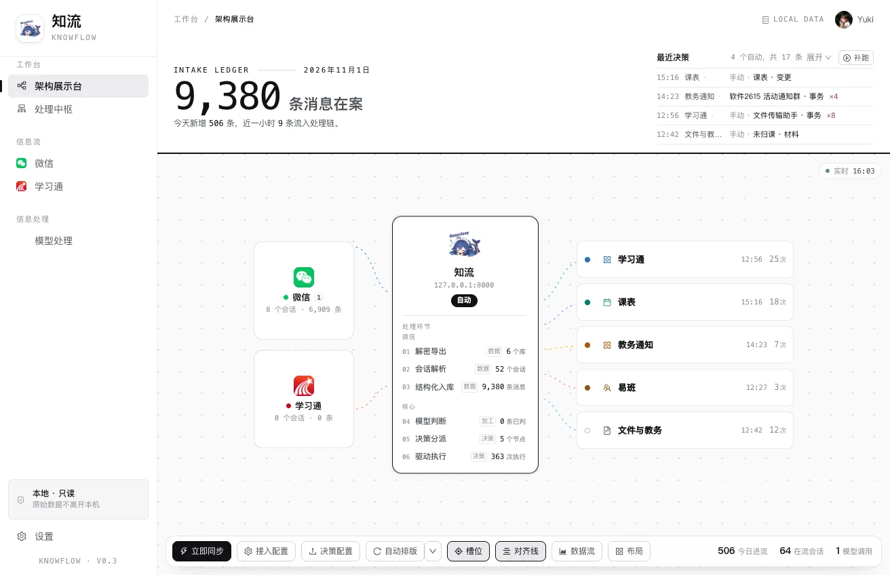
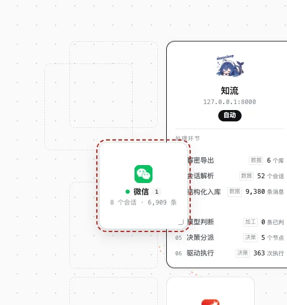
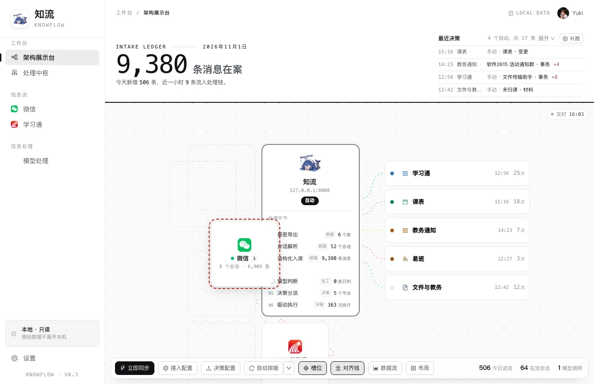
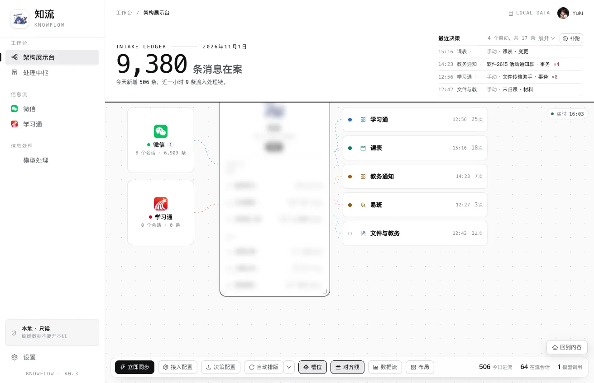
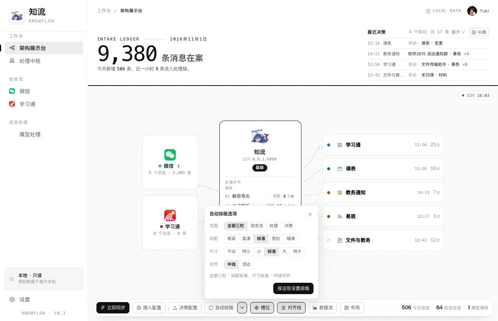
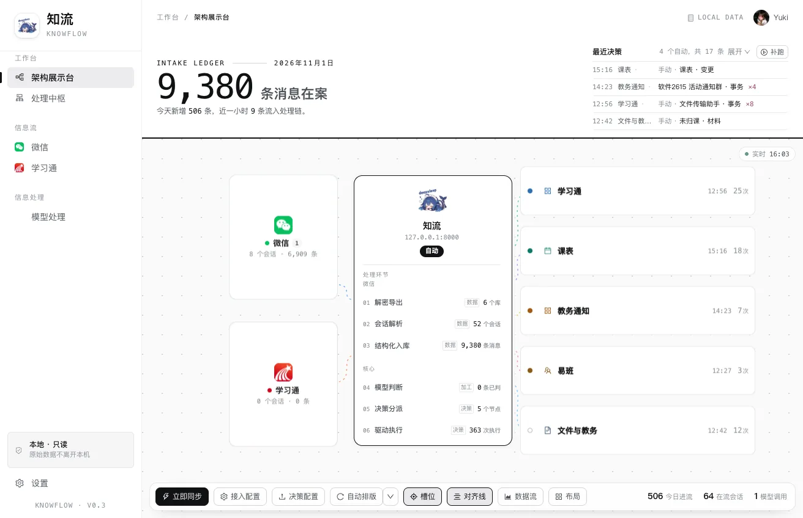
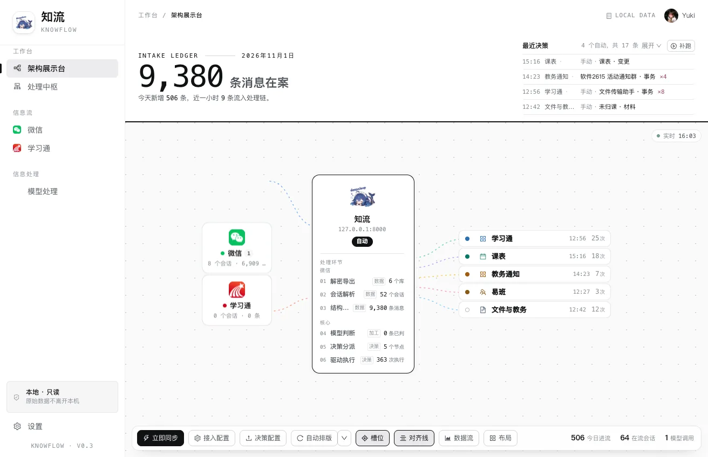
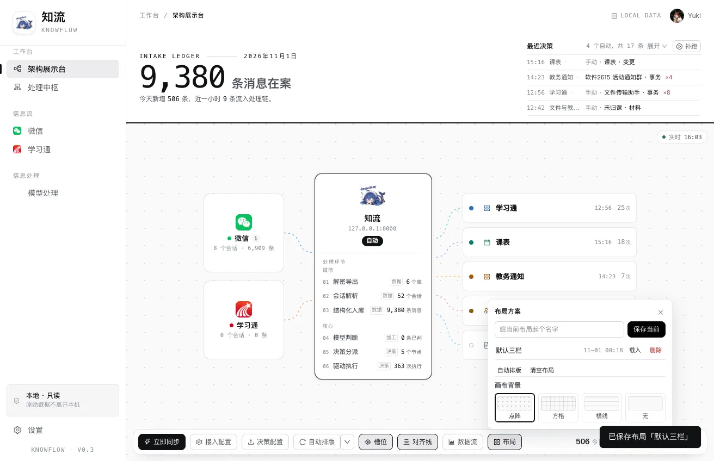

架构图一般是画完就定死的。知流的架构展示台想做另一种：这张图可以摆。

三条竖线分成三栏——信息流、处理中枢、决策。卡片住在栏里，虚线连着卡片。拖走一张，它得知道能落在哪儿；拉大一张，旁边的卡片不该跟着抖。这两句话听起来简单，实现起来几乎全部工作都在"边界"上：什么算放得下，什么算撞上了，什么算该重排。



## 三栏是骨架，卡片是浮在上面的

画布的主体是一个 grid：

```css
.canvas-pan {
  display: grid;
  grid-template-columns:
    148px 216px minmax(0, 320px);
  justify-content: center;
  column-gap: 56px;
}
```

三列宽度不是三等分。左侧来源卡只有图标、名字、两行计数，148 够了；中枢要放开六个处理环节，216；右侧决策行是"名称 + 时间 + 次数"，最长的一条到时间还剩一百多像素，320 留出十来个字的余量。整组居中，两边留白，看起来才像一张图而不是一张表。

卡片本身不参加布局：

```css
.tier-scroll > .node-card,
.lane-hub > .node-card {
  position: absolute;
  left: 0;
  top: 0;
  width: 100%;
}
```

位置一律走 `transform: translate(x, y)`。这一条决定了后面所有事情的前提：移动一张卡片，不会引起任何回流，三栏的竖线不会动，其他卡片更不会跟着挪。之前用文档流排卡片时，拖动一张，下面的卡片会被"顶"一下再弹回来——那不是动画，是布局在重排。


## 坐标要两个数才够

只存 `x / y` 是不够的，因为卡片的"家"会变。

窗口一窄，栏的位置、卡片自身的高度都变了。这时候如果还按原来的 `x / y` 摆，整块会歪。所以每个偏移里存两套数：`x, y` 是位移，`nx, ny` 是当时的自然位置。自然位置不用 `rect` 反推，直接用 `offsetLeft / offsetTop` 加 `offsetParent` 的矩形——`rect` 是渲染后的位置，位移没生效时读到的是旧值，反推出来会差一整个位移。

窗口变化时对账：新自然位置和旧的自然位置差多少，位移就补多少。视觉上卡片一动不动，实际上坐标系已经换了一套。

```ts
// 卡片的偏移就是这一份，width / height 有值才代表用户调过尺寸
type CardOffset = { x: number; y: number; w?: number; h?: number; nx?: number; ny?: number };
```

存盘的 key 带版本号（`knowflow:arch-offsets:v2`）。上一版坐标基准是"文档流自然位置 + 位移"，这一版换成"栏左上角 + 位移"，同一个数套进去整组会偏。宁可让旧布局失效重新排一遍，也不要载入一个错的。

## 槽位不是画网格，是从已有卡片推出来的

拖动时画布上会出现一圈虚线卡影，那是"松手能落在哪儿"。它不是预先铺好的网格，而是每次拖动现算的，候选有四类：

1. **原位**。从哪儿拖出来的，就一定能放回哪儿，哪怕那一栏已经空了。
2. **列的上下空档**。同一列两张卡之间的缝、排到列尾的位置。
3. **行的左右空档**。同一行两张并排卡之间、或者并到行尾。
4. **八向邻位**。某张卡的左边、右边、左上、右下……

先把所有候选点收进来，再统一判断"这块地方是不是空的"。顺序反了会出事：一个放不下的槽如果先被收下，它周围真正能放的槽就会被它的占位挤掉。

判断完还要过三道筛子：不能压住任何一张卡（缝隙按 0 算）、至少八成落在当前视野里（卡身露一角还能抓住，虚线框缺一半就只剩几根断头线）、以及 24px 以内的重复点合并成一个。

```ts
const slot = {
  // id 里带尺寸：两次拖动的卡不一样大，落点可能一样。
  // 只按坐标认，"正在吸哪个槽"会串到上一次
  id: `${Math.round(left)},${Math.round(top)}:${w}x${h}`,
  left, top, w, h,
};
```

列和行要先把已有卡片"聚"成线才能算。手拖出来的列不会像素级对齐，左缘差几像素被当成两列的话，每列都会算出一串槽，画布上就是一片虚线。容差给的 36px（列）和 20px（行）。



吸附不用"最近距离"，用磁场：横向半径 140、纵向半径 36，归一化之后距离小于 1 就吸。

```ts
const d = Math.hypot((slot.left - left) / 140, (slot.top - top) / 36);
```

为什么是椭圆不是圆？栏里是上下排卡，纵向才是落位的主轴。指针在两张卡中间偏左一点，意图通常是"插到这两张之间"，而不是"往左挪 30 像素"。同分时再给一个纵向偏置，让吸到的槽总是最贴近当前高度的那一个。

卡影只画落点附近 96px 内的最多 5 个。候选能到几十处，全画出来是一地虚线框，反而看不出重点。正在吸的那一个无论如何都画。



## 放不下的时候要说话

拖到别人身上，卡片照常跟着手走，只是外面多一圈红色虚线，松手退回原位。不做半透明——压在别人身上时下层文字会透上来，反而看不清自己拖的是哪张。

拖到画布空白处，那里没有卡影可贴，但也不该被当成禁区。矢量画布上"离所有卡都远"是常态，所以给一圈很淡的实线轮廓，意思是"这儿没槽，但能放"。

这两种状态对应两个 class：`.drop-blocked` 和 `.drop-free`。落位被拒时还会在落点上方弹一句话，写明是压在谁身上还是出了画布，1.9 秒自己散。

边界还有两处容易漏：卡片至少要露出 88px 才算"看得见"，否则松手就等于把卡片扔到屏幕外；拖到画布边缘 72px 的带子里，视野会自己往那侧滑，最快 8px 一帧——再快就变成"一碰边整张纸飞出去"，位置全靠追。

## 缩放：撞上就停

每张卡右下角有 32×32 的手柄。按住拖动时，卡片内容会被一层磨砂盖住：

```css
.card-frost { backdrop-filter: blur(7px); }
```

用 `backdrop-filter` 而不是 `filter` 是有原因的。`filter` 会把 1px 描边和手柄一起打码，尺寸反而没法判断；磨砂只糊背后的内容，边框和手柄留在外面继续清晰。1.6px 的模糊几乎看不出差别，等于白做，7px 才盖得住文字重排的接缝。

大小不是想拉多大就多大。往右拉，先看右边最近一张卡的距离；往下拉，先看下方最近一张卡的距离。撞上就停，那个方向拉不动了——不推开邻居，也不压过去。

```ts
// 只统计"竖着跟我重叠"的卡，它们的左缘减去我的右缘就是余量
function rightClearance(el, current) {
  let best = Infinity;
  panEl.querySelectorAll(".node-card").forEach((node) => {
    if (node === el) return;
    const r = node.getBoundingClientRect();
    if (r.bottom <= current.top + 2 || r.top >= current.bottom - 2) return;
    if (r.left < current.right - 2) return;
    best = Math.min(best, r.left - current.right);
  });
  return best;
}
```

早先的做法是"撞上了就把邻居推开"，看着像卡片之间有弹簧，实际是把别人的位置改了。现在邻居一辈子不动，动不了的只有自己。



## 自动排版：四个维度，一次做完

自动排版的弹层最上面是一排综合档：密排、均衡、展台。每一档把尺寸、间距、对齐配好成对给，点一下连排版一起跑完，不用来回调四个维度。下面才是可以单独动的四行：范围（全部三栏 / 只排某一栏）、间距（极紧 / 紧凑 / 标准 / 宽松 / 铺满）、尺寸（不动 / 特小 / 小 / 标准 / 大 / 特大）、对齐（中线 / 顶边）。



它是"一次性"的：点一下，按当前选择摆一遍，然后结束。不监听窗口变化，不等面板展开，也不会在后台偷偷再跑一遍。所以手摆过的位置能留住——这一条被反复要求过，因为早期版本会在窗口一动的时候把用户刚摆好的卡片冲掉。

### 间距：五档，底子跟着尺寸走

间距档都是相对"这一栏自己的行距"算的，不写死像素。来源栏 10px、决策栏 5px，是设计上定的疏密，档位乘法叠在它上面，不会把 5px 的五条决策行拆散。

五档的系数是 0.15 / 0.4 / 1.5 / 2.6 / 均分剩余高度。

间距还管三栏之间的栏距，28 / 40 / 56 / 72 / 88px——一栏里排得密、两栏之间却隔着一条马路，整块就散了。栏距有个下限：卡片是绝对定位的，中枢在"特大"时宽到 259，而那一栏只有 216，多出来的 43 就伸进栏距里。所以栏距至少比溢出多留 12px，否则卡片会直接压在决策栏上。

光有系数还不够。卡片放大一倍，同样的 15px 在眼里就只剩一半，于是"特大 + 标准"看起来比"标准 + 标准"挤。所以间距还乘了一个随尺寸档抬升的底子：

```ts
const SIZE_GAP_BASE = { keep: 1, xs: 0.85, sm: 0.92, md: 1, lg: 1.18, xl: 1.4 };
```

底子在"标准"档是 1，默认观感不变。这一层只抬整条线，间距到底多松仍由那五档说了算。

### 尺寸：不是乘一个系数，是按身高补差

统一乘 1.2 会放大落差本身。中枢天生 369 高，来源卡 96，决策行 34。同一个系数乘下去，中枢多出 74px，来源卡只多出 19px——档位越大，落差在眼里越明显，两边反而更小气。

所以每张卡的实际倍数按它和中枢的身高比再补一笔：

```ts
const lift = 1 + scale.lift * (1 - Math.min(1, card.height / refH));
const h = card.height * scale.h * lift;
```

和中枢一样高不补，矮一半补一半的量，档位越大补得越狠。宽度不补：卡片都从栏的左缘往右长，中枢从 204 起、决策栏从 476 起，宽度超过 1.26 倍就顶上去，所以宽度只取到 1.2，留十几像素的余量。

五档的 lift 分别是 0 / 0.32 / 0.63 / 0.87 / 1.05：增量为负，一档比一档加得少。因为 lift 是乘法项，等加会让效果越往后越猛。按"目标身高"反解出来，相邻两档看起来才差不多。

补完还要收。一栏卡片加起来高过可用区时，等比缩回去，栏内相对大小不变，下限是内容需要的高度——宁可这一栏多占一点画布（超出的靠平移看），也不切内容。中枢是单张卡，没有邻居可让，高度直接封在可用区，多出来的部分在它内部的滚动体里滚。





实测（1312×848，标准间距）来源卡 / 中枢 / 决策行的身高：

| 档位 | 来源卡 | 中枢 | 决策行 |
| --- | --- | --- | --- |
| 特小 | 130×95 | 190×369 | 282×31 |
| 小 | 139×115 | 203×369 | 301×43 |
| 标准 | 148×145 | 216×380 | 320×55 |
| 大 | 163×175 | 238×410 | 352×68 |
| 特大 | 178×205 | 259×443 | 384×80 |

决策行的身高按 12 / 12 / 13 / 12 递增，来源卡是 20 / 30 / 30 / 30。最前面那一档差得少，是因为来源卡在 130 宽时内容要占掉 95，再小就得裁字了。

## 动画：FLIP，两段

排版是一次整体搬家，直接改 `transform` 就是瞬移。所以用 FLIP：改之前量一遍每张卡的位置，改完再量一遍，拿差值倒着放动画。

飞行段 460ms，不是直线平移，是"抬起来飞过去"——中途向上拱 16px、放大 5%，落点上方再压下来。拱起的曲线用 24 帧采样自己画，缓出曲线只管快慢。错峰 10ms，最多累计 90ms，再多整体就像卡了一下。

落地段 340ms：触地瞬间挤一下（100% → 97.2% → 100.6% → 100%），原点在底边，所以是往下压再弹回来；同时外扩一圈涟漪，560ms 消散。

动画全部走 WAAPI，随时能被拖动打断。打断就 `cancel`，回到内联的 `transform`，没有"动画和手写样式打架"的中间态。

有一个不写就踩的坑：改完 `transform` 必须立刻量，但卡片上带着 0.12s 的过渡（hover 微移用的），不关掉的话量到的还是旧位置，差值恒为 0，动画永远不触发。所以排版前给整个平移层加 `.reflow-lock`，`transition: none`，量完再摘。

## 代码里那几个不写就会踩的坑

**拖动时不进响应式。** 拖拽只写 DOM，`transform` 直接改元素，一帧最多算一次。走 `reactive` 的话，每次指针移动都要重渲染整块画布，掉帧是必然的。

**尺寸用 `offsetWidth` 而不是 `rect.width`。** 卡片落地时有一下 `scale(1.03)` 的脉冲，那一瞬间量到的宽度会大 3%，按它算出来的槽、卡影、落位位置全部跟着偏几个像素。

**`border-box` 要补描边。** 量内容需要多高时，`scrollHeight` 不含边框，1px 的上下描边漏掉，最后一行的字会被切掉半截，看起来像渲染坏了。

**内容兜底要量两层。** 中枢的内容装在一个自己会滚的容器里，卡片的 `scrollHeight` 永远是"刚好填满"，缩高度时丢掉的几条环节量不出来。所以还要往里找 `overflow: auto | scroll` 的元素，把它藏起来的高度也算进去。

**堆叠态要把位移整组作废。** 容器窄到 980px 以下，三栏变一列，卡片回到文档流。这时桌面端存下来的 `translate` 必须无视，否则卡片会被推到列外面去。

**存储全部带版本号。** 坐标基准、尺寸档的键名（`small / normal / large` 换成了 `sm / md / lg`）都变过。旧数据要能读：键名换了的走一张映射表，基准变了的直接作废重排。

## 可以直接搬走的四个小算法

**一维聚簇。** 给一堆坐标和一个容差，输出若干条"线"（线的值是组内中位）。列、行、对齐线都用它。容差要按对象给：列 36，行 20。

**空档生成。** 一列卡片按 `top` 排序，相邻两张之间就是候选；第一张上方、最后一张下方单独留出口子。行同理。这套东西不需要知道布局是几栏、每栏有几张，只认矩形。

**磁场吸附。** 把像素距离按半径归一化，`hypot < 1` 才算吸。横纵半径分开给，就能表达"这个方向宽容、那个方向严格"。

**分配。** 间距压不下就均分剩余高度（上限 40），还放不下就等比收卡片（下限是内容），最后才允许溢出、靠平移看。三层依次生效，每一层都有自己的下限，不会出现"为了塞下把字切了"。

## 边界

没做的三件事：多选、画布缩放、卡片编组。多选要先想清楚"多选之后能做什么"，不然只是框一下；画布缩放会和槽位、碰撞、平移三处的手感打架，现在平移够用；编组会让"槽位"这套矩形推导失效，得先有层级。

只要这三件事没做，这套实现就还是"一张能摆的图"，而不是一个 Figma。对展示台来说，够用。




---

整个画布装在一个 Vue 单文件组件里，五千多行。模板和样式不到三分之一，剩下的是逻辑，以及解释这些边界为什么这么定的注释。
